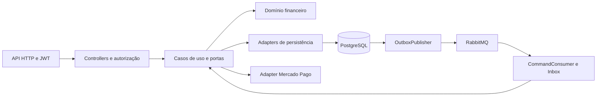

# Oficina Billing Service

[](https://sonarcloud.io/summary/new_code?id=AuroNet0_tech-challenge-oficina-billing-service)
[](https://sonarcloud.io/summary/new_code?id=AuroNet0_tech-challenge-oficina-billing-service)

Serviço financeiro da oficina, implementado em Java 21 e Spring Boot, responsável por orçamentos, decisões e pagamentos.<br>
Recebe comandos do OS pelo RabbitMQ e mantém seus dados financeiros em PostgreSQL.<br>
Oferece consultas e decisões autenticadas e integra Checkout Pro do Mercado Pago em ambiente de testes.<br>
Publica resultados via Outbox como participante da Saga orquestrada pelo OS.

## 1. Arquitetura do serviço



Pacotes reais sob `com.oficina.billing`:

| Pacote | Responsabilidade |
| --- | --- |
| `domain/model`, `domain/enums`, `domain/exception` | Agregados, estados e regras financeiras |
| `application/usecase`, `application/payment` | Comandos, consultas, decisões e workflow do provedor |
| `application/port/in`, `application/port/out`, `application/authorization`, `application/message` | Portas, autorização por OS e envelope |
| `infrastructure/web` | Controllers, DTOs, JWT, autorização e erros |
| `infrastructure/persistence` | Entidades, repositórios, mapeamento e adapters JPA/JDBC |
| `infrastructure/messaging`, `infrastructure/payment`, `infrastructure/config` | RabbitMQ, workers, Mercado Pago e configuração |

## 2. API e segurança

Matriz conferida nos controllers e em [SecurityConfig](src/main/java/com/oficina/billing/infrastructure/config/SecurityConfig.java). Os papéis são requisitos de acesso; as operações financeiras também exigem autorização atual da OS.

| Método | Caminho | Papel (role) exigido |
| --- | --- | --- |
| GET | `/api/v1/orcamentos?osId={osId}` | `CLIENTE`, `ATENDENTE` ou `GERENTE` |
| GET | `/api/v1/orcamentos/{id}` | `CLIENTE`, `ATENDENTE` ou `GERENTE` |
| GET | `/api/v1/orcamentos/{id}/aprovacao` | `CLIENTE`, `ATENDENTE` ou `GERENTE` |
| POST | `/api/v1/orcamentos/{id}/aprovar` | `CLIENTE` |
| POST | `/api/v1/orcamentos/{id}/rejeitar` | `CLIENTE` |
| GET | `/api/v1/pagamentos?osId={osId}` | `CLIENTE`, `ATENDENTE` ou `GERENTE` |
| GET | `/api/v1/pagamentos/{id}` | `CLIENTE`, `ATENDENTE` ou `GERENTE` |
| POST | `/api/v1/pagamentos/{id}/checkout` | `CLIENTE` |
| GET | `/api/v1/notificacoes?osId={osId}&page={page}&size={size}` | `CLIENTE` |
| POST | `/api/v1/webhooks/mercado-pago` | Sem JWT humano; assinatura HMAC do provedor |
| GET | `/actuator/health`, `/actuator/health/liveness`, `/actuator/health/readiness` | Público |
| GET | `/swagger-ui/index.html`, `/v3/api-docs` | Público na configuração atual |

**Swagger/OpenAPI:** a política de não publicação não foi identificada. O POM inclui Springdoc, [OpenApiConfig](src/main/java/com/oficina/billing/infrastructure/config/OpenApiConfig.java) declara a API e a segurança permite `/swagger-ui/**` e `/v3/api-docs/**`. A opção `disable-swagger-default-url: true` não desabilita a publicação da documentação.

O canal de negócio usa `Authorization: Bearer <JWT>`, sem sessão e com CSRF desabilitado. [AuthJwtDecoder](src/main/java/com/oficina/billing/infrastructure/web/security/AuthJwtDecoder.java) valida assinatura RS256 via JWKS HTTPS (`BILLING_JWKS_URI`), igualdade exata de `iss` com `BILLING_JWT_ISSUER` e presença de `BILLING_JWT_AUDIENCE` em `aud`, que deve ser lista de strings. Os valores confiáveis são fornecidos por ambiente; os exemplos de issuer/JWKS em `.env.example` precisam ser substituídos.

O decoder exige `typ=JWT`, `kid` não vazio, `sub` e `jti` UUID canônicos, datas inteiras `iat`, `nbf`, `exp`, `nbf=iat`, expiração futura e duração máxima de 900 segundos, sem tolerância de relógio. `roles` deve ser lista sem duplicatas contendo apenas `CLIENTE`, `ATENDENTE`, `MECANICO` e `GERENTE`; é convertida em `ROLE_<nome>`. Lista vazia não concede acesso financeiro; `MECANICO` não tem acesso às rotas financeiras. As demais rotas/métodos são negados.

Além do papel, `FinancialAuthorization` exige decisão positiva para a OS e a finalidade `READ`, `DECIDE` ou `CHECKOUT`; notificações usam `DECIDE`. No perfil `mtls`, `MtlsFinancialAccessAdapter` consulta o OS por HTTPS, encaminha o JWT original e valida ator, OS, ação e correlação da resposta. A identidade TLS depende da configuração da JVM, demonstrada no compose de integração. Fora desse perfil, `UnavailableFinancialAccessAdapter` retorna indisponibilidade e as operações dependentes respondem 503. Negação retorna 403; ausência ou invalidade do Bearer no canal financeiro retorna 401. Consulte [autorização financeira](docs/security/billing-authorization-8.3.4.md) e [notificações](docs/notificacoes-orcamento.md).

## 3. Dados

O banco é **PostgreSQL (SQL)**, com nome padrão `oficina_billing`, substituível por `DB_NAME`. O [compose local](compose.yaml) provisiona PostgreSQL 17 com volume `billing-postgres-data`; o [compose de integração](integration/9.1.4/compose.yaml) separa `billing-db` (`e2e_billing`) dos bancos dos demais serviços. Isso confirma banco próprio do Billing nas configurações locais; o nome físico do banco no EKS não foi identificado.

Flyway executa as migrações de `src/main/resources/db/migration`; Hibernate usa `ddl-auto: validate`:

| Migração | Conteúdo |
| --- | --- |
| `V1__bootstrap_schema.sql` | Bootstrap com `SELECT 1` |
| `V2__create_billing_domain.sql` | Orçamentos, itens, aprovações, pagamentos e tentativas |
| `V3__create_messaging_tables.sql` | Inbox e Outbox |
| `V4__mercado_pago_integration.sql` | Checkout, notificações do provedor, reconciliação e observações financeiras |
| `V5__create_quote_notifications.sql` | Notificações internas de orçamento |

## 4. Mensageria

Topologia conferida em [RabbitMessagingConfig](src/main/java/com/oficina/billing/infrastructure/messaging/RabbitMessagingConfig.java) e em [mensageria](docs/messaging.md). As exchanges são `topic` duráveis.

| Exchange | Finalidade |
| --- | --- |
| `oficina.commands` | Receber comandos do OS |
| `oficina.events` | Publicar resultados do Billing |
| `billing.commands.retry` | Encaminhar entregas para repetição |
| `billing.commands.dlx` | Encaminhar entregas para DLQ |

| Fila durável | Exchange / routing key |
| --- | --- |
| `billing.quote.create` | `oficina.commands` / `quote.create.v1` |
| `billing.payment.request` | `oficina.commands` / `payment.request.v1` |
| `billing.quote.create.retry` | `billing.commands.retry` / `quote.create.v1` |
| `billing.payment.request.retry` | `billing.commands.retry` / `payment.request.v1` |
| `billing.commands.dlq` | `billing.commands.dlx` / `#` |

As filas de retry têm TTL (`COMMAND_RETRY_DELAY`, padrão `5s`) e retornam à exchange de comandos. O limite `COMMAND_MAX_DELIVERIES` é 5 por padrão, incluindo a entrega inicial. Falhas permanentes seguem para DLQ; falhas transitórias têm rollback e encaminhamento confirmado antes do ACK. A DLQ não retorna automaticamente à fila principal.

Comandos consumidos: `quote.create.v1` e `payment.request.v1`. Eventos publicados via Outbox: `quote.created.v1`, `quote.creation-failed.v1`, `quote.approved.v1`, `quote.rejected.v1`, `payment.confirmed.v1` e `payment.failed.v1`. O envelope preserva OS, Saga e correlação; comandos exigem `source=os-service`, e eventos usam `source=billing-service`. Esse campo não autentica o produtor no broker.

`inbox_messages` deduplica por `eventId`; a transação inclui os efeitos locais e os eventos correspondentes. `outbox_events` mantém o envelope persistido, com leases, tentativas e backoff. `OutboxPublisher` exige publisher confirm e roteamento válido. A entrega é **at-least-once**, com possibilidade de republicação do mesmo evento; não há garantia exactly-once.

## 5. Papel na Saga e compensação

O Billing é **participante**; o [os-service](https://github.com/AuroNet0/tech-challenge-oficina-os-service) é o orquestrador, conforme os contratos referenciados em [mensageria](docs/messaging.md) e o harness local.

`quote.create.v1` cria orçamento pendente, notificação interna e evento `quote.created.v1`; dados semanticamente inválidos podem produzir `quote.creation-failed.v1`. A decisão autorizada do cliente produz `quote.approved.v1` ou `quote.rejected.v1`. `payment.request.v1` exige orçamento aprovado e cria pagamento lógico `PENDING`, sem abrir checkout ou comprovar cobrança. O resultado financeiro verificado produz `payment.confirmed.v1` ou `payment.failed.v1`.

O Billing não possui handler de comando de compensação nem implementa refund/chargeback automático. Os estados da OS e da Saga são responsabilidade do OS. O [roteiro de integração](integration/9.1.4/README.md) registra rejeição de orçamento com OS `CANCELADA` e Saga `COMPENSATED`; falha de reparo pode terminar em Saga `FAILED` e exigir intervenção manual. Isso não representa estorno financeiro executado pelo Billing.

## 6. Como executar localmente e testar

Pré-requisitos: Java 21 para Maven, Docker com containers Linux e Docker Compose. Os testes de integração usam **Testcontainers com PostgreSQL e RabbitMQ reais**, portanto exigem Docker disponível.

Copie o [arquivo de exemplo](.env.example) e configure os valores locais antes de subir o serviço:

```powershell
Copy-Item .env.example .env
```

| Grupo | Variáveis |
| --- | --- |
| PostgreSQL | `DB_HOST`, `DB_PORT`, `DB_NAME`, `DB_USERNAME`, `DB_PASSWORD` |
| JWT | `BILLING_JWT_ISSUER`, `BILLING_JWT_AUDIENCE`, `BILLING_JWKS_URI` |
| RabbitMQ | `RABBITMQ_HOST`, `RABBITMQ_PORT`, `RABBITMQ_USERNAME`, `RABBITMQ_PASSWORD`, `RABBITMQ_VHOST` |
| Mercado Pago opcional | `MERCADO_PAGO_ENABLED`, `MERCADO_PAGO_RECONCILIATION_ENABLED`, `MERCADO_PAGO_ACCESS_TOKEN`, `MERCADO_PAGO_WEBHOOK_SECRET` e URLs descritas em [Mercado Pago](docs/mercado-pago.md) |

O compose exige senha de banco, senha do broker e as três variáveis JWT. O `.env` é usado pelo Compose; não é carregado automaticamente pelo Maven. O compose define `DB_HOST=postgres` e porta interna `5432` para a aplicação; `DB_PORT` no arquivo de ambiente controla a porta de PostgreSQL no host.

Para usar um broker já existente, configure host, porta e credenciais desse broker e execute:

```sh
docker compose up --build -d --wait
```

Para o broker opcional do próprio compose, use PowerShell:

```powershell
$env:RABBITMQ_HOST = 'rabbitmq'
$env:RABBITMQ_PORT = '5672'
docker compose --profile local-broker up --build -d --wait
```

O serviço fica em `http://127.0.0.1:8082`, com porta interna `8080`; PostgreSQL é publicado por padrão em `127.0.0.1:5434`. O perfil `local-broker` publica RabbitMQ em `5674` e management em `15674`, ambos no loopback. Outros serviços precisam apontar para o mesmo broker para participar do fluxo. A subida local padrão não habilita o canal mTLS de autorização financeira; JWT válido sozinho não libera operações dependentes da OS.

```sh
./mvnw clean verify
```

No Windows: `./mvnw.cmd clean verify`. Relatórios gerados: `target/surefire-reports/`, `target/site/jacoco/index.html` e `target/site/jacoco/jacoco.xml`. Para encerrar a stack local preservando volumes: `docker compose stop`; se utilizou o perfil opcional, use `docker compose --profile local-broker stop`.

## 7. Qualidade e cobertura

O [POM](pom.xml) executa JaCoCo em `verify`, com gate agregado `BUNDLE`, contador **LINE**, valor `COVEREDRATIO` e mínimo **0,80**. O CI também exige cobertura de linhas de pelo menos 80% e ausência de testes com falha, erro ou ignorados.

Cobertura SonarCloud informada para a análise de **13/11/2026: 86,7%**. Esse valor e a data foram fornecidos para esta documentação; não há relatório dessa análise identificado no repositório. Projeto: [Oficina Billing no SonarCloud](https://sonarcloud.io/summary/new_code?id=AuroNet0_tech-challenge-oficina-billing-service).

A imagem `docs/img/sonarcloud.png` não foi identificada no repositório. A referência solicitada `` fica registrada como texto, sem incorporar imagem com caminho inexistente.

## 8. CI/CD

O [workflow atual](.github/workflows/ci.yml) define `verify` para pull requests e pushes em `main` e `homolog`, além de execução manual (`workflow_dispatch`).

O job `verify` configura Java 21, testa os scripts de CI e executa [verify.py](scripts/ci/verify.py): varredura heurística de segredos, Maven Wrapper `clean verify`, testes e gate JaCoCo, build Docker `linux/amd64`, inspeção da imagem e verificação de runtime em compose isolado. O runtime valida usuário sem privilégios de root, Java 21, health/liveness/readiness, Flyway, consumidores RabbitMQ e encerramento por SIGTERM. A análise SonarCloud vem em seguida; a espera bloqueante pelo **Quality Gate ocorre somente em push na `main`**. A ausência de `SONAR_TOKEN` reprova a análise. Relatórios JSON sanitizados são coletados mesmo em falha e retidos por sete dias.

O job `deploy` depende de `verify` e roda **somente em push na `main`**. Obtém credenciais AWS por OIDC e faz preflight do EKS e ECR. Se receber `ResourceNotFoundException` do EKS ou `RepositoryNotFoundException` do ECR, registra `deploy=skip`, contemplando ambiente desligado/removido; outros erros fazem o job falhar. Quando ambos existem, usa o checkout do SHA exato e cria/publica a imagem com tag `GITHUB_SHA`, ou reutiliza a tag existente sem sobrescrevê-la. A configuração de imutabilidade do repositório ECR não é verificada pelo workflow.

O deploy resolve o digest `sha256`, executa `kubectl set image` com referência `repositorio@digest` e aguarda `kubectl rollout status` por até 300 segundos. Há serialização dos deploys, sem cancelar o que estiver em andamento. Não há rollback automático no workflow.

| Secret/variável | Origem e finalidade |
| --- | --- |
| `SONAR_TOKEN` | Secret do GitHub para análise SonarCloud |
| `GITHUB_TOKEN` | Token fornecido pelo GitHub Actions à etapa SonarCloud |
| `AWS_ROLE_ARN` | Variável do GitHub (`vars.AWS_ROLE_ARN`) para assumir a role por OIDC |

Região, cluster, namespace, ECR, Deployment e container são definidos no workflow. Detalhes em [CI/CD](docs/ci.md).

## 9. Implantação

O workflow prepara a atualização do Billing no EKS e pressupõe um Deployment existente. A geração dos recursos pelo stack `platform` de `tech-challenge-oficina-k8s-infra` foi informada no escopo desta documentação; sua implementação e URL não foram identificadas nos arquivos deste repositório. O workflow não comprova que o ambiente esteja atualmente ligado ou que um rollout já tenha ocorrido.

| Item | Valor confirmado |
| --- | --- |
| Região AWS | `us-east-1` |
| Cluster EKS | `tc-oficina-p4-demo-a` |
| Namespace | `tc-oficina-p4-demo-a` |
| Deployment / container | `billing-service` / `billing-service` |
| Repositório ECR | `tc-oficina-p4-demo-a-billing` |
| Registry ECR | Resolvido com o ID da conta retornado por `aws sts get-caller-identity` |
| Porta da imagem | `8080`, conforme [Dockerfile](Dockerfile) |
| Health | `/actuator/health` |
| Liveness | `/actuator/health/liveness` |
| Readiness e HEALTHCHECK da imagem | `/actuator/health/readiness` |

A pasta `k8s/` contém [k8s/billing-service.yaml](k8s/billing-service.yaml), com manifestos de referência (ServiceAccount, ConfigMap, Service e Deployment) que espelham o que o stack `platform` do repositório `tech-challenge-oficina-k8s-infra` aplica no EKS. Os valores entre `<...>` (endpoint do RDS, issuer/audience/JWKS, URLs do Mercado Pago, conta AWS e tag da imagem) são fornecidos pela infraestrutura em cada ambiente; segredos de TLS, banco, RabbitMQ e Mercado Pago são referenciados por nome e não ficam no repositório. O arquivo não é aplicado diretamente por este repositório: o Deploy da infraestrutura provisiona e aplica os recursos no cluster, enquanto o job `deploy` do `ci.yml` apenas atualiza a imagem do Deployment (`kubectl set image`).

Conforme [application.yml](src/main/resources/application.yml), readiness inclui estado da aplicação e banco; RabbitMQ não participa do health. Detalhes internos do health não são expostos.

## 10. Integração Mercado Pago

O adapter implementa **Checkout Pro via Preferences API**. O POST de checkout exige pagamento existente, autorização do cliente e elegibilidade financeira. A preferência e seu link não confirmam pagamento. A integração e a varredura adicional de reconciliação são desabilitadas por padrão; o adapter restringe o uso ao ambiente financeiro de testes e entrega `sandbox_init_point`.

O webhook `POST /api/v1/webhooks/mercado-pago` usa HMAC-SHA256 em `x-signature`, com `x-request-id`, `data.id` e janela temporal; valida também a correspondência do ID no corpo. Registra receipt durável e deduplicado. O worker consulta o provedor e verifica identidade, referência, tentativa, valor e moeda antes de aplicar o resultado e gravar a Outbox. Timeout ou indisponibilidade não equivalem a pagamento recusado. Reconciliação recupera resultados sem webhook; `UNKNOWN` e `REVIEW` podem exigir intervenção.

Os testes Maven usam [ProviderTestServer](src/test/java/com/oficina/billing/payment/ProviderTestServer.java), servidor HTTP local do JDK, junto a Testcontainers. O compose de integração usa o mock Python existente em `integration/7.6/mock/server.py`, montado em loopback do Billing. Testes simulados não comprovam homologação com o provedor oficial. Detalhes em [Mercado Pago](docs/mercado-pago.md).

## 11. Teste BDD de fluxo completo

O cenário Gherkin [oficina.feature](integration/9.1.4/oficina.feature) descreve a conclusão de uma OS com diagnóstico, notificação e aprovação de orçamento, reparo e pagamento aprovado. O resultado esperado, consultado por HTTP pelo runner, é pagamento **`CONFIRMED`**, OS **`FINALIZADA`** e Saga **`COMPLETED`**.

O [runner.py](integration/9.1.4/runner.py) é **próprio, em Python, e não usa Cucumber-JVM**. `validate_feature()` valida os passos; `run_bdd()` executa as funções correspondentes. `start.ps1` executa `python /runner.py bdd` no container do runner sobre o [compose de integração](integration/9.1.4/compose.yaml), com serviços e mensageria reais e provedor simulado.

O [roteiro 9.1.4](integration/9.1.4/README.md) exige quatro repositórios clonados lado a lado: `tech-challenge-oficina-auth`, `tech-challenge-oficina-os-service`, `tech-challenge-oficina-execution-service` e este Billing, em `homolog`. O harness monta `integration/8.3.5` do **repositório Auth** e `docker/` do **Execution**; essas pastas não são fornecidas pelo Billing. Exige Java 21, Maven e Docker Desktop Linux; `prepare.ps1` também usa Git, OpenSSL e keytool, com caminhos configuráveis.

Execute a partir da raiz do Billing, substituindo `<RunRoot>` pelo diretório emitido por `prepare.ps1`:

```powershell
powershell -NoProfile -ExecutionPolicy Bypass -File integration/9.1.4/prepare.ps1
powershell -NoProfile -ExecutionPolicy Bypass -File integration/9.1.4/verify.ps1 -OutputDirectory '<RunRoot>/verify'
powershell -NoProfile -ExecutionPolicy Bypass -File integration/9.1.4/start.ps1 -RunRoot '<RunRoot>'
powershell -NoProfile -ExecutionPolicy Bypass -File integration/9.1.4/summarize-memory.ps1 -RunRoot '<RunRoot>'
powershell -NoProfile -ExecutionPolicy Bypass -File integration/9.1.4/collect.ps1 -RunRoot '<RunRoot>' -VerificationDirectory '<RunRoot>/verify'
```

Se o JAR do Auth ainda não existir, execute antes `verify.ps1` com um diretório de saída novo e exclusivo e use esse diretório em `collect.ps1 -VerificationDirectory`, conforme o roteiro. Não reutilize arquivos de execução parcial fora dos checkpoints documentados. Chaves, JWTs, `private.env` e logs privados não devem ser publicados. As evidências versionadas são históricas; esta revisão documental não executa o cenário.

## 12. Estrutura do repositório

| Pasta/arquivo | Conteúdo |
| --- | --- |
| `src/main/java/com/oficina/billing/` | Domínio, aplicação e infraestrutura |
| `src/main/resources/` | Configuração e migrações Flyway |
| `src/test/` | Testes de domínio, aplicação, persistência, segurança, API, mensageria e provedor |
| `docs/` | Mensageria, Mercado Pago, notificações, segurança e CI |
| `k8s` | Manifestos Kubernetes de referência do serviço |
| `integration/9.1.4/` | Harness E2E/BDD, compose e evidências históricas |
| `scripts/ci/` | Verificador, testes dos scripts e compose de runtime |
| `.github/workflows/` | Workflow de verificação e deploy |
| `compose.yaml`, `Dockerfile`, `pom.xml` | Execução local, imagem e build Maven |

## 13. Auditoria desta documentação

### Afirmações não confirmadas

- Política de não publicação do Swagger/OpenAPI: não identificada; a configuração atual permite acesso público.
- Captura `docs/img/sonarcloud.png`: não identificada; a imagem não foi incorporada para evitar link quebrado.
- Cobertura SonarCloud de 86,7% em 13/11/2026: informada no pedido, sem relatório local identificado dessa análise.
- URL e implementação do stack `platform` de `tech-challenge-oficina-k8s-infra`: não identificadas neste repositório; nenhum link foi deduzido.
- Nome físico do banco no EKS, estado atual do ambiente, execução remota dos jobs e política de imutabilidade do ECR: não identificados pelos arquivos locais.
- Execução atual do cenário BDD: não realizada nesta revisão documental; os resultados versionados são históricos.

### Divergências entre documentação anterior e código

- README e `docs/ci.md` declaravam ausência de CI/CD, deploy e publicação de imagens e afirmavam Actions desabilitado. O workflow atual define verificação, análise SonarCloud e deploy condicional; a habilitação remota do Actions não é comprovada por esse arquivo.
- O documento da etapa 8.3.4 descrevia o adapter indisponível como única implementação de produção em todos os perfis e a integração distribuída como não iniciada. O código atual contém adapter `mtls`; o fallback indisponível é ativado fora desse perfil.
- `docs/messaging.md` tratava o adapter do provedor e os eventos financeiros como futuros. O código atual implementa checkout, webhook, reconciliação e eventos de pagamento via Outbox; o consumo de `payment.request.v1` continua sem chamada externa.
- O documento de segurança descrevia projeção mínima para todos os funcionários. `FinancialAuthorization.operational()` aplica a projeção quando existe `ROLE_ATENDENTE`; `GERENTE` sozinho recebe o DTO financeiro após autorização.
- Os roteiros antigos apontavam para etapas anteriores de integração; os links solicitados foram atualizados para o roteiro 9.1.4. O compose dessa etapa ainda reutiliza o mock de `integration/7.6`.

### Links relativos corrigidos e validação

- Antigos links do README para `integration/8.3.5/README.md` e `integration/8.3.5/relatorio.md` foram substituídos por referências existentes da etapa 9.1.4.
- Em `docs/mercado-pago.md`, os links para `../integration/7.5/relatorio.md` e `../integration/7.5/provider-http-evidence.json` foram substituídos pelo roteiro e pelo relatório versionado de 9.1.4; são evidências de outra execução, sem atribuir a elas os resultados históricos da 7.5.
- Em `docs/security/billing-authorization-8.3.4.md`, a referência textual a `integration/7.6/relatorio.md` foi substituída por links para o roteiro e o runner atuais.
- Os links relativos ativos do README e dos documentos alterados foram conferidos no filesystem e apontam para arquivos existentes. O caminho da imagem ausente aparece somente como texto.
