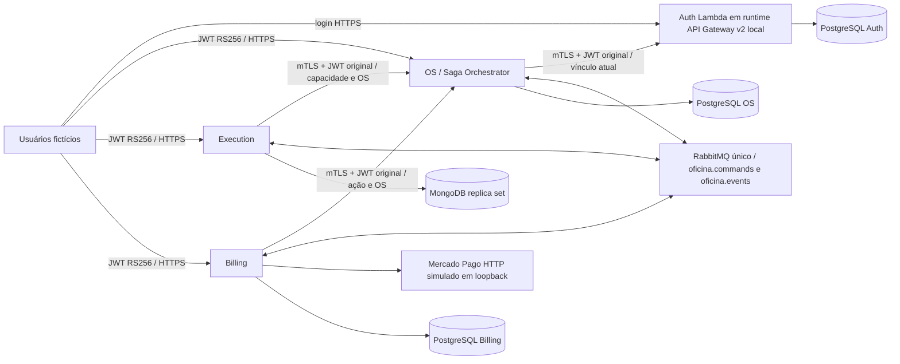

# FIAP Fase 4 — Etapa 8.3.5

## Estado da validação

**Integração local aprovada em 26/10/2026: 134 verificações do harness passaram.**
Pagamento CONFIRMED, OS FINALIZADA e Saga COMPLETED pelos fluxos reais das aplicações.
Os quatro clean verify passaram: 598 testes, zero falhas/erros/skips e cobertura acima de 80%.
A execução final exigiu retomadas documentadas de provisionamento e de resposta perdida da
aprovação; não foi uma execução contínua sem incidentes. Nenhum estado de negócio foi forçado.
O resultado não representa validação real em AWS ou no Mercado Pago oficial.

## Arquitetura e contratos

### Repositórios analisados antes das alterações

Todos em homolog e inicialmente sem alterações locais. Nenhum commit/push foi feito;
as mudanças desta etapa permanecem na árvore de trabalho. A evidência registra também
SHA-256 dos JARs efetivamente executados, comparados com os artefatos de clean verify.

| Repositório | HEAD analisado |
| --- | --- |
| Auth | `0f26aa8ee36230ee9dbd3ff0bb244da62c347503` |
| OS | `8d551aacee92fdf71448b271c2ae9e2712830693` |
| Execution | `c4f07b64abaab093f1c18049c7a2cc71bda218b8` |
| Billing | `82603d24c310bf44b5a3d478afce2512e6402614` |

Revisados os documentos de identidade/autenticação e segurança 8.3.2-A/A1/B, 8.3.3,
8.3.4; portas ClientAccess/TechnicalAuthorization/FinancialAccess, grants/atribuições,
controllers, Saga, RabbitMQ/Inbox/Outbox, PaymentWorkflow/ProviderTransactions, webhook,
reconciliação e roteiros 7.6. Os adapters indisponíveis eram a dependência deliberadamente
fechada. Não foi necessária alteração estrutural além das extensões pedidas nesta etapa.

Identidade técnica: TLS com CA efêmera da execução, certificado distinto por serviço e
allowlist exata do subject CN. O engine TLS valida cadeia, validade e prova de posse.
O servidor OS aceita certificado opcional no handshake para permitir usuários humanos,
mas exige certificado validado nas rotas internas; não lê X-User-Id, X-Roles ou headers
de certificado de proxy. Apenas Execution pode chamar a decisão técnica e Billing a financeira.
O Auth local aceita somente OS. Bearer é sempre protegido por TLS nesses canais.
Referências: [JSSE/HttpsConfigurator](https://docs.oracle.com/en/java/javase/21/docs/api/jdk.httpserver/com/sun/net/httpserver/HttpsConfigurator.html)
e [Spring Boot SSL](https://docs.spring.io/spring-boot/reference/features/ssl.html).

Configuração local: perfil `mtls`, keystore/truststore próprios em JSSE e TLS do servidor.
`OFICINA_INTERNAL_AUTH_URI` configura o endpoint Auth no OS; `OFICINA_INTERNAL_OS_URI`
configura as respectivas decisões no Execution e Billing. Os endpoints devem ser HTTPS,
sem credenciais/query/fragmento e com path exato. O perfil padrão conserva os adapters
indisponíveis; não existe fallback positivo ou flag que desligue autenticação.

JWT humano: assinatura/issuer/audience/claims verificados independentemente no destino.
Execution/Billing encaminham o token do SecurityContext autenticado; o OS exige igualdade
entre sub e usuarioId de correlação. O UUID isolado nunca comprova identidade. A consulta
OS→Auth contém clienteId, JWT original, requestId e issuedAt; o Auth verifica formato/frescor,
usuário ativo, papel CLIENTE atual e vínculo atual dentro do caso de uso existente.
Resposta somente `{"autorizado":boolean}`, no-store. O Auth não informa PII.

`POST /internal/technical-authorization`: usuarioId, osId, capability, correlationId.
Resposta correlacionada com esses quatro campos e allowed. Allowlist fechada das sete
capacidades técnicas; papel MECANICO e atribuição ativa específica são obrigatórios.
Migração incremental OS V7 amplia apenas a constraint; V1–V6 são preservadas.

`POST /internal/financial-authorization`: usuarioId, osId, action READ/DECIDE/CHECKOUT,
correlationId. Resposta correlacionada com allowed. CLIENTE exige vínculo do proprietário
real da OS; ATENDENTE/GERENTE podem READ com OS_READ da filial; demais ações requerem
CLIENTE proprietário. Nenhum papel implica acesso global. Billing continua resolvendo
osId pelo agregado persistido e derivando responsavelId do JWT.

Na 8.3.5, GERENTE recebe os DTOs financeiros de consulta após autorização de filial;
ATENDENTE mantém somente id/osId/status. Isso atualiza a projeção resumida de gerente
registrada historicamente na 8.3.4. Ambos continuam impedidos de aprovar pelo cliente
ou iniciar checkout sem propriedade CLIENTE comprovada.

Sem cache positivo de grants. Cada operação refaz a consulta. Falha de rede/TLS/parsing
ou resposta incorreta falha fechada; negação é 403 e indisponibilidade é 503 no serviço
de origem. Sem atomicidade distribuída entre decisão e commit. Papéis de funcionários
continuam sujeitos ao TTL máximo de 900 segundos; revogação de atribuição é relida.

## Docker e provisionamento

Compose isolado `oficina-e2e835-<id>`; sem portas publicadas no host e volumes por projeto.
Auth usa namespace de rede de seu PostgreSQL para manter a política local de JDBC loopback
existente. Cada aplicação usa banco independente; nenhuma aplicação consulta banco alheio.
MongoDB possui replica set e autenticação. O único broker preserva exchanges/contratos.

O harness invoca o RequestHandler Lambda real com APIGatewayV2HTTPEvent para login e JWKS;
não executa o Runtime Interface Emulator nem emula IAM. A operação interna local usa o
mesmo caso de uso e verificador JWT, com prova do certificado obtida da sessão TLS.
O handler produtivo mantém seu contrato AWS e a rota interna produtiva permanece fechada.

Fixture CLI Auth, fora do JAR produtivo, usa os casos de uso e Argon2id reais. Seu autorizador
é limitado aos usuários da execução e pares exatos para vínculos. Não cria endpoint admin.
O runner administrativo, exclusivo do E2E, prepara duas filiais e grants explícitos nas tabelas
existentes, respeitando FKs, checks de não autoconcessão, auditoria e unicidade. Cadastro de
cliente/veículo e abertura de OS usam HTTP autenticado. Atribuições técnicas têm gerente
como concedente; a revogação registra identidade, data e versão. Não muda estado de Saga,
OS, diagnóstico, orçamento ou pagamento por SQL. A proveniência de bootstrap é o ID da
execução local, não uma conta HTTP com permissões universais.

São seis contas: atendente, mecânico, gerente, clientes A/B e uma sem papel para negativos.
Senhas aleatórias, dados fictícios, nenhuma conta em migração. Os IDs e papéis ficam em
provisioning.json sanitizado; credenciais e chaves ficam apenas em artifacts ignorado.

## Cenários executados

Principal: atendente abriu OS do cliente B, mecânico atribuído concluiu diagnóstico, cliente B
aprovou orçamento, mecânico concluiu reparo, cliente B iniciou checkout e webhook HMAC disparou
consulta ao mock. Resultado: pagamento CONFIRMED, OS FINALIZADA e Saga COMPLETED.

Negativos: cliente A contra OS/orçamento/checkout de B; mecânico contra OS não atribuída;
atendente concluindo reparo; gerente aprovando; sem papel; JWT inválido/expirado; certificado
ausente, serviço errado e certificado não confiável; escolha de usuarioId terceiro; outra OS;
capacidade não técnica; escrita com grant revogado mantendo leitura; dependência OS indisponível.
Snapshots antes/depois verificaram ausência de mutações. Checkout repetido, webhook repetido,
reentrega de comando e DLQ foram exercitados. Parada e retorno do broker recuperaram a Outbox.

Falha financeira, UNKNOWN, REVIEW, concorrência, retry e reconciliação têm evidência nas suítes
atuais dos serviços; distinguir essa validação da Saga completa integrada. Consumidores não
recebem JWT humano, e o teste de recuperação comprovou isso com comando criado durante outage.

## Resultado E2E final e evidências

Execução `4a21f181-8a36-474f-9089-c3c8be1849de`, projeto Docker
`oficina-e2e835-4a21f1818a36`. Resultado global: [PASSED](evidence/validation-global.json).
134 verificações = 23 de preflight/provisionamento + 93 do fluxo com retomada + 10 de
dependência indisponível + 7 de outage + 1 de recuperação. O fluxo retomado preservou
os checks anteriores e acrescentou seis novos logins reais e a confirmação de aprovação pela API.

| Recurso principal | ID / estado |
| --- | --- |
| Filial autorizada | `8f5371b2-899c-41c8-8161-11a778c81605` |
| Cliente B, proprietário | `e521dcb5-d4df-46f2-abaa-5f98d04bdef6` |
| Veículo B | `7c3f9455-b7e0-491a-b6f4-ea4a393b3c2d` |
| OS | `ff9a70fe-706b-40b6-bf7f-320e31bec889` — FINALIZADA |
| Saga | `36765109-3bfa-4c00-ab62-b903b6dbf9e7` — COMPLETED |
| Diagnóstico | `f33ccbe4-3536-44d7-b52b-0ae5a8fb5912` — concluído |
| Orçamento | `6504d95d-99b2-4ed3-a3ac-7635b518007a` — APPROVED, versão 1 |
| Reparo | `de3114f9-40ee-43ca-af68-7cde890d6a9d` — concluído |
| Pagamento | `4c211506-af40-43ea-b9dc-00dc37fd2522` — CONFIRMED, BRL 150,00 |

Uma aprovação por cliente autenticado, uma preferência simulada e uma tentativa financeira
confirmada. O provedor retornou `approved`, `live_mode=false` e valor BRL 150,00. A evidência
do mock registra GETs reais de Billing em `/v1/payments/200001`; webhook não confirmou por
corpo ou alegação do cliente. Checkout e webhook repetidos não duplicaram a operação.

Sequência observada: WAITING_DIAGNOSTIC → WAITING_QUOTE → WAITING_APPROVAL →
WAITING_REPAIR → WAITING_PAYMENT → COMPLETED. Os eventos diagnostic.start/completed,
quote.create/created/approved, repair.start/started/completed, payment.request/confirmed
mantiveram contratos v1 e correlação. A Outbox/Inbox registra os IDs e estados;
reentrega diagnostic.start foi consumida sem alteração de agregado/histórico/novos eventos.
Um comando deliberadamente inválido terminou na DLQ sem mutação de negócio.

Na indisponibilidade do broker, a OS de recuperação `3ace4e36-68e5-40e5-959f-478dfa3d5dce`
persistiu comando PENDING com tentativa 1. Após retorno, o mesmo evento
`0164b51b-73c6-4372-9d8d-c95d954af491` terminou PUBLISHED, tentativas 2, e criou diagnóstico
`9d1e76b1-ac17-4506-b968-e489358e82f7` sem JWT humano. As OS secundárias usadas para
negação e recuperação não são apresentadas como Sagas completas.

### Autorização negativa

| Tentativa | Resultado final |
| --- | --- |
| Cliente A: OS/orçamento/pagamento/checkout de B | 403, sem mutação |
| Cliente A aprovar orçamento de B | 403, sem decisão/Outbox indevida |
| Mecânico consultar/alterar OS não atribuída | 403, sem mutação |
| Atendente concluir reparo ou iniciar checkout | 403, sem mutação |
| Gerente aprovar ou iniciar checkout pelo cliente | 403, sem mutação |
| Usuário sem papel | 403 |
| JWT inválido ou expirado com assinatura real | 401 |
| Rota interna sem certificado | 401 |
| Certificado de outro serviço/subject não permitido | 403 |
| Certificado não confiável | Rejeição TLS, nenhum HTTP aceito |
| Serviço válido com JWT humano inválido | 401 |
| Escolher usuarioId de terceiro | 403 |
| Decisão para outra OS | allowed=false, alvo/correlação preservados |
| Capacidade operacional usada como técnica | 403 |
| Escrita/conclusão após revogação, leitura mantida | 403, sem mutação |
| OS indisponível para Execution e Billing | 503, sem mutação/reserva financeira |

### Ambiente e conservação

Dez containers saudáveis ao fim da coleta, bancos independentes, Flyway Auth V2/OS V7/Billing V4,
Mongo PRIMARY, exchanges/bindings conferidos e filas vazias antes do provisionamento.
Docker Engine 29.7.2, Java Temurin 21.0.12.1, PostgreSQL 17.11, MongoDB 8.0.32 e RabbitMQ 4.3.6.
Image IDs e hashes dos JARs ficam na evidência. Os seis containers normais preexistentes
mantiveram IDs e estado running; nenhum comando da entrega alterou ou removeu seus volumes. As duas stacks E2E
anteriores foram paradas, preservando volumes e artefatos; a stack final fica disponível à revisão.

Arquivos sanitizados em [evidence](evidence): verification, revisions, artifact-sha256,
runtime-versions, containers, preservation, provisioning, assignment-audit, http-trace,
approval, diagnostic, repair, payment, order-final, saga-final, provider-evidence,
financial-state, Inbox/Outbox, dependency-unavailable, broker-outage/recovery e queues-dlq.
Credenciais, JWTs, chaves privadas, stores e logs completos não foram promovidos.

## Limitações e infraestrutura futura

Tudo é local; nenhum teste ou recurso real AWS. Handler Lambda produtivo, adapters SigV4,
contratos RabbitMQ, domínio, transações financeiras e único orquestrador são preservados.
O runtime local não emula IAM/API Gateway nem comprova autorização IAM. Para AWS/Kubernetes:
definir transporte de workload, emissão/rotação/revogação de certificados ou SigV4 com Gateway
confiável, truststores, políticas de rede, gestão de segredos e ACL/TLS do broker. Não encaminhar
certificados via headers sem terminação/prova confiável aprovada. Não executar Terraform/deploy.

O ambiente acadêmico usa broker e bancos em rede Docker privada; mTLS protege os canais HTTP.
O mock HTTP é loopback do Billing. Credenciais de fixture são locais e descartáveis; não usar
esta topologia como arquitetura produtiva. CLI administrativa permanente e política de revogação
de papéis além do TTL continuam pendentes. Evidências promovidas ao repositório devem ser
sanitizadas; não copiar private.env, fixture.json, JWTs, stores ou logs completos.

Comandos de reprodução: [README](README.md). Sem commit/push, deploy ou início de outra etapa.

## Testes automatizados atuais

Todos os quatro clean verify foram executados com JDK 21 e Maven 3.10.0, usando bancos
e brokers reais Testcontainers. O OS foi reexecutado após a correção HTTP e o Billing
após ajustar a projeção do gerente. Os testes de produção não receberam exclusões,
skips ou redução do gate de cobertura. Total: **598 testes, zero falhas/erros/skips**.

| Serviço | Testes | JaCoCo linhas |
| --- | --- | --- |
| Auth | 84 | 92,83% |
| OS | 130 | 91,79% |
| Execution | 149 | 94,40% |
| Billing | 235 | 95,39% |

Os novos testes OS verificam certificado obrigatório, serviço correto, sujeito JWT,
correlação, capacidades explícitas, papel, revogação, vínculo e papel financeiro.
O teste HTTP com JWT RS256 real comprova o status 401 por certificado ausente sem
alteração em OS/histórico/Saga/Outbox. O teste de transporte HTTPS distingue status 401
de erro de conexão. As suítes Billing verificam a projeção do gerente/atendente, além
de todas as regras financeiras anteriores. Relatórios completos ficam nos respectivos
target/surefire-reports, Auth também target/failsafe-reports e target/site/jacoco.

## Problemas encontrados e correções

1. Git/Java/Maven/Docker não estavam no PATH do agente. Foram utilizadas as instalações
   locais existentes por caminho explícito; a política permanente do Windows não foi alterada.
2. A fixture HTTPS SigV4 preexistente sofreu timeout de conexão, convertendo o 401 esperado
   em indisponibilidade. O probe direto confirmou HttpConnectTimeoutException. A fixture
   usa loopback IPv4 explícito e conexão de até cinco segundos; o deadline de requisição
   e a asserção de timeout continuam ativos. O adapter SigV4 produtivo não foi alterado.
3. O primeiro preflight E2E detectou que o handler genérico OS convertia ResponseStatusException
   de certificado ausente em 500. Foi acrescentado mapeamento sanitizado no controller interno,
   com teste de regressão HTTP e novo clean verify. O preflight foi repetido antes do provisionamento.
4. A projeção anterior escondia detalhes financeiros também do gerente. A consulta GERENTE
   foi adequadamente distinguida do resumo ATENDENTE, mantendo autorização de filial e proibição
   de aprovação/checkout pelo funcionário. Billing foi revalidado e o E2E completo repetido.
5. O runtime local aguarda chave de assinatura ativa por health/polling, respeitando os 90 segundos
   de publicação antecipada do gerador Auth. Não foi reduzida a política de rotação para os testes.
6. A repetição E2E expôs uma corrida da fixture: o orçamento já existia no Billing enquanto
   quote.created ainda alterava a OS. O orçamento permaneceu PENDING_APPROVAL, sem decisão,
   mas a comparação global detectou a transição legítima concorrente. Foram adicionadas barreiras
   de polling WAITING_APPROVAL e EM_EXECUCAO antes dos snapshots negativos dessas fases;
   a igualdade dos snapshots continua obrigatória e não há alteração direta de estados.
7. Uma invocação inicial da CLI de vínculo falhou sem diagnóstico detalhado; a causa exata
   dessa ocorrência não foi comprovada. A repetição pelos casos de uso reais confirmou os
   dois vínculos, sem SQL de mutação. A fixture agora informa somente tipo/motivo sanitizado,
   reconhece pares já vinculados e permite retomar o checkpoint validado. Erros transitórios
   classificados têm retry limitado; autorização/configuração inválida continua falhando.
8. O POST de aprovação sofreu perda de resposta HTTP no harness, mas a decisão já estava
   persistida como APPROVED pelo cliente B e quote.approved foi publicado com retry.
   Não houve reenvio da decisão. Uma retomada explícita fez novo login e confirmou orçamento,
   aprovação e responsável pelas APIs reais antes de continuar. O trace preserva a ocorrência;
   o orçamento ficou na versão 1 e houve somente uma aprovação. A causa de transporte exata
   não foi determinada. O timeout do cliente E2E foi elevado de 12 para 60 segundos, sem
   alterar deadlines internos, JWT, domínio ou transações financeiras.

## Entrega para revisão

Implementação: runtime/fixture local em Auth; controller de decisões, adapter mTLS e V7 no OS;
adapter mTLS no Execution; adapter mTLS e projeção financeira do gerente no Billing. Os
adapters SigV4 preparados e os contratos de aplicação foram preservados. Harness, Compose,
reprodução e 36 JSONs sanitizados estão centralizados nesta pasta.

Coleta final: JARs executados iguais aos verificados por SHA-256, dez containers saudáveis,
seis containers normais preservados, JSONs válidos, busca por credenciais/JWTs/chaves privadas
sem ocorrência nas evidências, sintaxe dos scripts aprovada e git diff --check sem erros.
Branches homolog e HEADs iniciais preservados. Sem commit, push, deploy, Terraform ou
reativação de workflows. Recomenda-se revisar o diff e reproduzir o roteiro local antes
de aprovar esta entrega. O planejamento final do projeto e qualquer próxima etapa ficam
aguardando revisão; nenhuma implantação AWS/Kubernetes foi iniciada.
